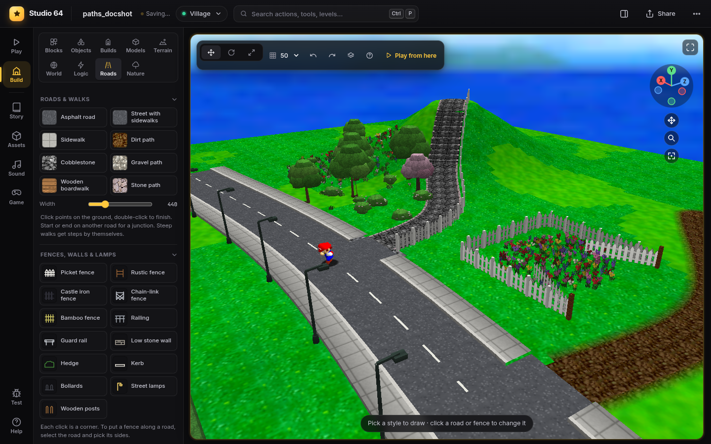
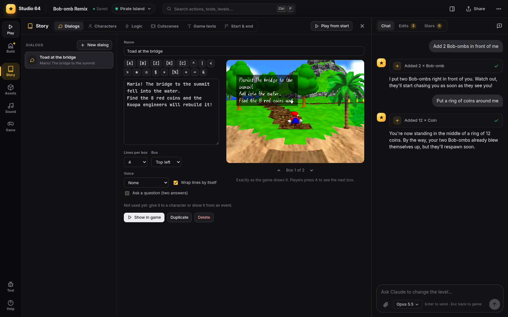
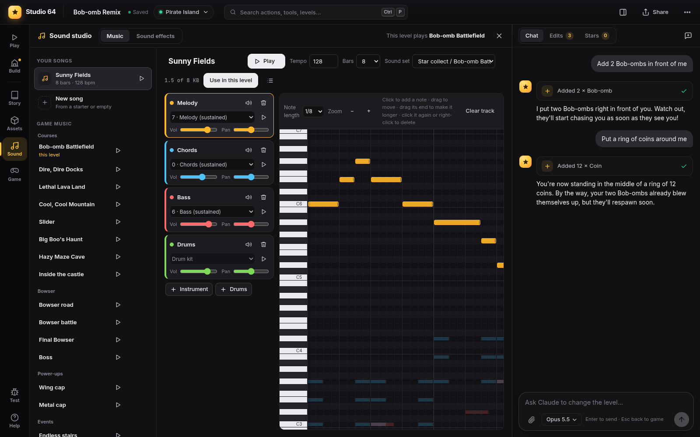
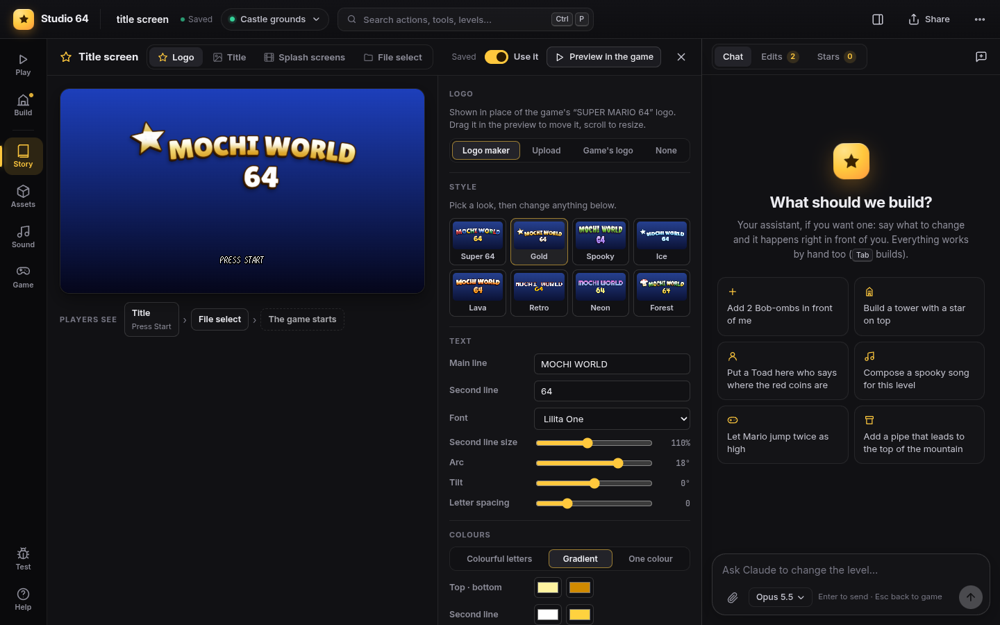

# Studio 64

**Create anything you ever wanted in Super Mario 64, in real time.**

[▶ Watch the trailer](https://www.youtube.com/watch?v=hcomzBaXxZo)

[Download](../../releases/latest) · [Getting started](docs/getting-started.md) · [Documentation](docs/README.md) · [FAQ](docs/faq.md)

Studio 64 is a level editor for Super Mario 64 that runs the real game in your browser, so every
change shows up while you play. Put down a platform, press `Tab`, and you're already jumping on it.
No emulator, no ROM patching, no waiting for a compile.

You need your own US copy of the game. Studio 64 doesn't include it (see [Legal](#legal)).

## Get started

Download `studio64-0.1.2-beta.zip` from [Releases](../../releases/latest) and unzip it. Then:

**Windows 10/11**: open the `Studio 64` folder and double-click **Start Studio 64**. If Windows says
"Windows protected your PC", click **More info**, then **Run anyway**.

**macOS 13+**: open the folder, right-click **Start Studio 64.command** and choose **Open**, then
**Open** again.

**Linux**: open a terminal in the folder and run `./start-studio64.sh`.

Your browser opens a setup page. Drop your Super Mario 64 ROM on it (`.z64`, `.n64` or `.v64`, zipped
is fine) and press **Build Studio 64**. The first build downloads about 1 GB and takes 5 to 10
minutes. After that it starts in a few seconds, offline too. Nothing gets installed system-wide and
you don't need an admin password.

The step-by-step version with pictures is in [Getting started](docs/getting-started.md).

Working on the code? `git clone`, then `npm start` (Node.js 18 or newer) does the same setup.
`docker compose up` works too.

## What you can do

| | |
|---|---|
|  |  |
| **Build by hand.** Blocks in 29 materials, about 600 of the game's objects, stairs and bridges in one click, undo for everything. | **Roads and nature.** Draw roads, paths and fences that follow the ground, then paint trees, flowers and rocks with a brush. |
|  |  |
| **Shape the ground.** Sculpt and paint terrain, even in the original levels, or start a new level from a template or a heightmap. | **Tell a story.** Dialogs in the game's own font, characters who talk, events, cutscenes, and every text in the game. |
|  |  |
| **Make the music.** Write songs in a piano roll, played with the game's own instruments, and swap any sound effect. | **Make it yours.** Your own title screen and logo, then export a real N64 ROM and a .bps patch you can upload anywhere. |

There's more: stars and red coins, moving platforms, enemies you put together from behavior blocks,
game rules (gravity, jump height, lives), doors, pipes and paintings, your own 3D models and
textures, and play-testing tools like save states and slow motion. A few extras come from
Shoggoth World, my other SM64 hack: drivable cars with races, Shotgun Mario, Katana Mario and a
night-time Tokyo level template. With your own Super Mario Sunshine disc you can also bring in
Piantas, Nokis and a few enemies.

Every feature has its own page in the [documentation](docs/README.md).

## Works without AI

Studio 64 is a complete editor with nothing but mouse and keyboard. No account, no AI, no internet
after the first setup.

If you want one, there's an optional assistant that builds with you: type "put a ring of coins around
me" and it uses the same tools you do, live in the game, and its edits undo like yours. It works with
Claude, OpenAI, Gemini, OpenRouter or a local model. When nothing is connected, the chat and every AI
button stay hidden. The trailer uses the assistant, but the car, the weapons and Bowser are all in
the object library too. Setup: [AI providers](docs/ai-providers.md).

## This is a beta

0.1.2-beta is the third beta. The setup was tested automatically from the release ZIP on five
Linux distributions (Ubuntu 22.04 and 24.04, Debian 12, Fedora, Arch). The first people to try it
on Windows and macOS found setup problems there, and this release fixes the ones reported so far. If
you try it on Windows or a Mac, I'd love to hear how it went, good or bad.

Found a bug? [Open an issue](../../issues/new/choose) with what you did and what happened. The
[troubleshooting page](docs/troubleshooting.md) covers the common setup problems.

## Documentation

- [Getting started](docs/getting-started.md): install, first run, your first hack in 5 minutes
- [FAQ](docs/faq.md) and [Troubleshooting](docs/troubleshooting.md)
- [Keyboard shortcuts](docs/keyboard-shortcuts.md)
- [ROM export](docs/rom-export.md): your hack as an N64 ROM and a .bps patch
- [All guides](docs/README.md): build mode, terrain, story, sound, world, assets, sharing
- For developers: [Architecture](docs/architecture.md), [Building the engine](docs/building-the-engine.md),
  [Testing](docs/testing.md), [Contributing](CONTRIBUTING.md)

## Legal

Studio 64 is a fan project. It isn't affiliated with or endorsed by Nintendo. *Super Mario 64*,
*Super Mario Sunshine* and Mario are trademarks of Nintendo.

This repository contains no ROM, no disc image and nothing extracted from the games. The setup
builds the game's assets from **your own** ROM on your own machine. What it builds (`web/engine/`
and the playable game export) contains Nintendo's code and assets, so keep it to yourself or share it
privately with people who own the game. Don't publish it or sell it. To share a hack with other
Studio 64 users, send them the project file (`.s64hack`). To share it with everyone, export it as a ROM hack and post the `.bps` patch: it only holds
your changes ([ROM export](docs/rom-export.md)).

The Shoggoth World content is my own work and ships with Studio 64. The few pieces of it that are
built on the game's own models (the dressed Toads and Goombas) ship as recipes, and the setup makes
them from your ROM ([details](docs/building-the-engine.md#the-shoggoth-content)).

## License and credits

Studio 64's own code is under the [MIT license](LICENSE). The engine in `engine/` is based on sm64ex
and the Super Mario 64 decompilation and keeps their terms.

Studio 64 stands on the work of a lot of people:

- [n64decomp/sm64](https://github.com/n64decomp/sm64), the Super Mario 64 decompilation
- [sm64ex](https://github.com/sm64pc/sm64ex), the PC port the engine is built on
- [Emscripten](https://emscripten.org), which turns it into WebAssembly
- [ws](https://github.com/websockets/ws), [marked](https://marked.js.org),
  [DOMPurify](https://github.com/cure53/DOMPurify), [zod](https://zod.dev),
  [Playwright](https://playwright.dev), the
  [Claude Agent SDK](https://www.npmjs.com/package/@anthropic-ai/claude-agent-sdk), and the Inter and
  JetBrains Mono fonts

Trailer music and sound credits are in [promo/CREDITS.md](promo/CREDITS.md).
