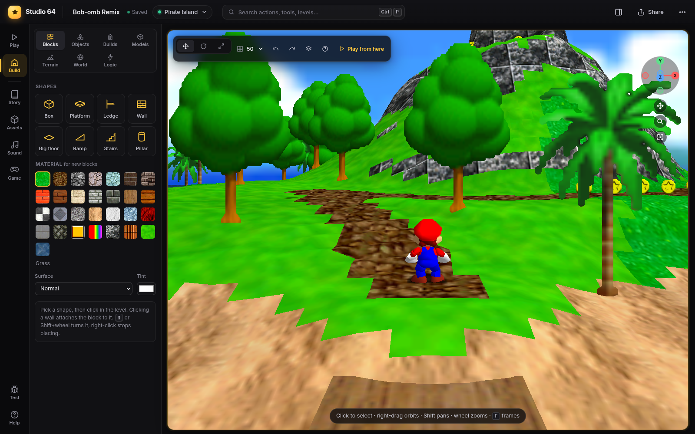

# Build mode

Build mode is the mouse editor. Press `Tab` (or **Build** in the rail) and the world pauses, the
camera works like in a 3D modelling program, and everything in the level can be clicked, moved,
changed and deleted. Press `Tab` again to play.

- [The camera](#the-camera)
- [The library](#the-library)
- [Block shapes](#block-shapes)
- [Selecting and changing things](#selecting-and-changing-things)
- [The inspector](#the-inspector)
- [The build bar](#the-build-bar)
- [Original level objects](#original-level-objects)
- [Saving and undo](#saving-and-undo)

## The camera

| Do this | To |
|---|---|
| Right-drag or middle-drag | Orbit around whatever is under the mouse |
| `Shift` + drag | Pan |
| Wheel, or `Ctrl` + drag, or pinch | Zoom toward the mouse |
| `Alt` + left / middle / right drag | Orbit / pan / zoom, like Maya |
| Double-click | Center on that spot |
| `F` | Frame the selection |
| `Home` / `Shift+Home` | Frame Mario / the whole level from above |
| Numpad `1` `3` `7` | Front / right / top view (with `Ctrl`: the opposite side) |
| Numpad `2` `4` `6` `8` | Orbit in 15° steps |
| Hold right mouse + `W` `A` `S` `D` `Q` `E` | Fly like in a game editor (`Shift` is faster) |

The **axis widget** in the top right corner of the game does the same with the mouse: drag it to
orbit, click X, Y or Z for side and top views, and use its pan, zoom and frame buttons.

## The library

The panel on the left has one tab per kind of thing you can add:

| Tab | What you get |
|---|---|
| **Blocks** | Boxes, platforms, ledges, walls, big floors, ramps, stairs, pillars, spheres, inner and outer corners for ramps and stairs, and terrain patches, with real collision, in 29 game materials (grass, bricks, wood, ice, lava, ...) and any tint. Pick one, then click in the level. Clicking a wall attaches the block to it, so you can build up a cliff. See [Block shapes](#block-shapes). |
| **Objects** | Every object of the game, about 600, with pictures: search, or browse by category (Popular, Sunshine, Enemies, Items, Bosses, Friends, Mechanics, Decoration). **My objects** holds your custom objects and prefabs. |
| **Builds** | Generators: staircase, spiral staircase, wall climb, bridge, floating platforms, tower. Click where it goes, tune it (a live preview shows it), then press **Build**. |
| **Models** | Your imported 3D models. See [Assets](assets.md). |
| **Roads** | Roads, streets, sidewalks and paths through points you click, fences, walls, hedges and lamps along lines. See [Roads and nature](roads-and-nature.md). |
| **Nature** | A brush that plants trees, flowers, grass, rocks and mushrooms. See [Roads and nature](roads-and-nature.md#the-nature-brush). |
| **Terrain** | Sculpt and paint brushes, level settings (sky, music). See [Levels and terrain](levels-and-terrain.md). |
| **World** | Areas, doors, warps, paintings, zones and the level's environment. See [World](world.md). |
| **Logic** | Characters, zones and events for the story. See [Story](story.md). |

While placing, every click adds one more. `R` or `Shift`+wheel turns what you are placing;
right-click or `Esc` stops.

## Block shapes

| Shape | |
|---|---|
| **Box** (also platform, ledge, wall, big floor) | A box of any size |
| **Ramp** | Rises toward its far side (+Z before you turn it) |
| **Stairs** | Steps up toward its far side; Mario walks up them (their collision is a grippy ramp through the steps) |
| **Pillar** | A round column, 24 sides; the texture wraps around it at the same size as on a box |
| **Inner ramp**, **Outer ramp** | Ramp corners. The outer one goes around a convex corner (a plateau's corner: it rises to one high corner), the inner one fills a concave corner (two ramps meeting inside an L). Each continues a ramp on two sides without a step, the texture turned with each ramp |
| **Inner stairs**, **Outer stairs** | The same for stairs: steps that turn the corner, mitred on the diagonal |
| **Sphere** | A ball (an ellipsoid when its sizes differ). Mario stands and runs on its top and slides off its sides |
| **Terrain** | A patch of ground you sculpt with the terrain brushes, anywhere and at any height. See [Terrain patches](levels-and-terrain.md#terrain-patches) |

**Corners next to ramps and stairs.** Give a corner the ramp's (or stairs') depth on both sides
(the presets match the library's ramp and stairs) and place it with the same turn as one of them:

- an **outer** corner continues a ramp at its right (+X) side with the same turn, and one turned
  90° at its far (+Z) side;
- an **inner** corner continues a ramp at its left (−X) side with the same turn, and one turned 90°
  at its near (−Z) side.

Turn the corner with `R` (45° steps) or the rotate handles to put it at any of the four corners.

## Selecting and changing things

Click anything to select it: a block, an object, a star, a warp. Then:

| Do this | To |
|---|---|
| Drag it | Slide it over the ground (`Shift`: up and down) |
| `1` | Move handles (axis arrows) |
| `2` | Rotate handles: rings around X (red), Y (green), Z (blue) and the view (white) |
| `3` | Resize handles (block faces) or scale |
| `R` | Turn 45° |
| `G` | Drop it to the ground |
| `Ctrl+D` | Duplicate |
| `Del` | Delete |
| `Ctrl+C` / `Ctrl+V` | Copy and paste, also into another level |
| `Alt` while dragging | Ignore the grid |

**Turning in 3D.** With `2`, drag a ring to turn the selection around that axis: the green ring
turns it like `R` does, the red one tilts it forward and back, the blue one rolls it sideways, the
outer white ring turns it around the direction you look in. It turns in 15° steps (`Alt`: freely),
the angle shows in the middle while you drag. Blocks turn around their middle, objects around
their feet. Every block and object keeps all three angles: they are saved, undone and exported to
the ROM like the rest, and the inspector shows them as **Rotation** (around Y), **Tilt** (X) and
**Roll** (Z). Some of the game's objects stand themselves upright again when they move in play
(enemies that walk, for example); blocks, models, coins, platforms and decorations stay as you
turned them.

**Several at once:** `Shift`- or `Ctrl`-click adds to the selection, dragging on empty space
draws a selection box, and `Ctrl+A` selects everything you built. Moving, turning (on any of the
rings: the others turn around the one with the handles), duplicating or deleting then works on
all of them.

**The scene panel** (`O`, or the layers button) lists everything in the level: search it, hide
or lock things, rename them, align and distribute a selection, and save a group as a **prefab**
to place again anywhere. Details: [Objects](objects.md#scene-panel-multi-select-prefabs).

## The inspector

When something is selected, the inspector replaces the library on the left:

- **Position, rotation and size** as numbers.
- For blocks: **shape** (the ten shapes as buttons; hover one for its name), **material** and **tint**, **steps** for
  stairs and stairs corners, **grid** for terrain patches, and **collision**:
  the surface (normal, grippy, slippery, ice, lava, hangable ceiling, hard, death floor,
  vanish-cap wall), *Invisible* and *No collision*.
- For objects: friendly choices where they matter (which star, what is in a `!` box, a Goomba's
  size, a coin formation's shape, ...) and the raw **behavior params** (`bparams`, see the
  [glossary](glossary.md#objects)).
- **Motion**: make it move along a path, spin, swing, tilt, fall, crumble, blink, carry Mario or
  bounce him. See [Objects: motion](objects.md#motion-moving-platforms-and-more).
- **Make it talk**: any Toad, sign or character can say one of your dialogs. See [Story](story.md).
- For doors, pipes and warps: where they lead (**Link…**) and what they need (stars, a key).
  See [World](world.md#warps).

## The build bar

The bar floating over the game:

| Button | |
|---|---|
| Move / rotate / resize | The handle mode (`1` `2` `3`) |
| Grid | Snap step: off, 25, 50 (default), 100, 200 units |
| Undo / redo | `Ctrl+Z` / `Ctrl+Shift+Z` |
| Layers | The scene panel (`O`) |
| `?` | A card with all build controls |
| **Play from here** | Leave build mode with Mario on the ground where the camera looks. `P` does the same at the spot under the mouse. |

## Original level objects

The objects the level already has (Goombas, trees, coins, ...) can be selected, moved, changed or
deleted too. Studio 64 then removes the original and spawns a saved copy in its place, so the
change comes back every time the level loads. A few original objects can only be deleted, not
changed; the editor tells you when.

## Saving and undo

There is no save button. Every edit goes to the server right away and comes back whenever the
level loads: after a reload, a death, or a trip to another level.

- `Ctrl+Z` undoes the newest edit of the level you are in, or of the whole project (a story,
  asset or sound edit), whichever came last; `Ctrl+Shift+Z` (or `Ctrl+Y`) redoes.
- The **Edits** tab in the side column lists every change of the project, each with its own
  undo button.
- **Version history** in the ⋯ menu restores the whole hack to an earlier point.
  See [Projects](projects.md#version-history).
