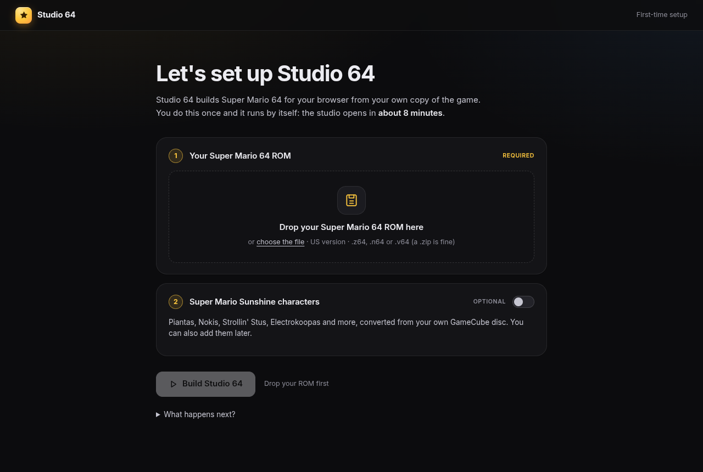
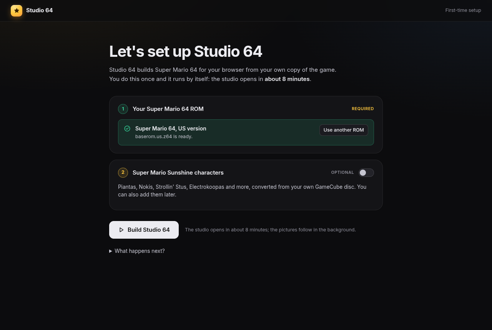
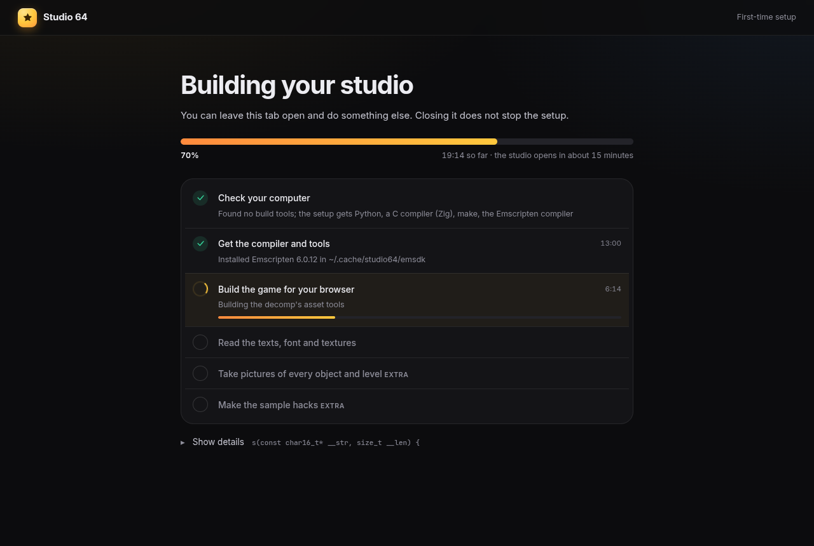
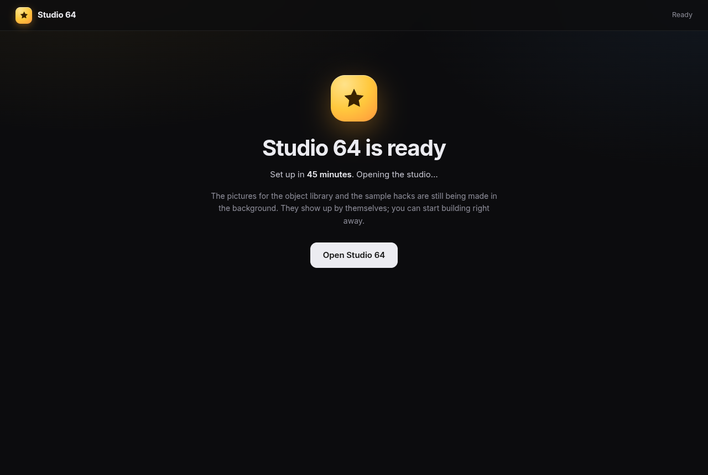
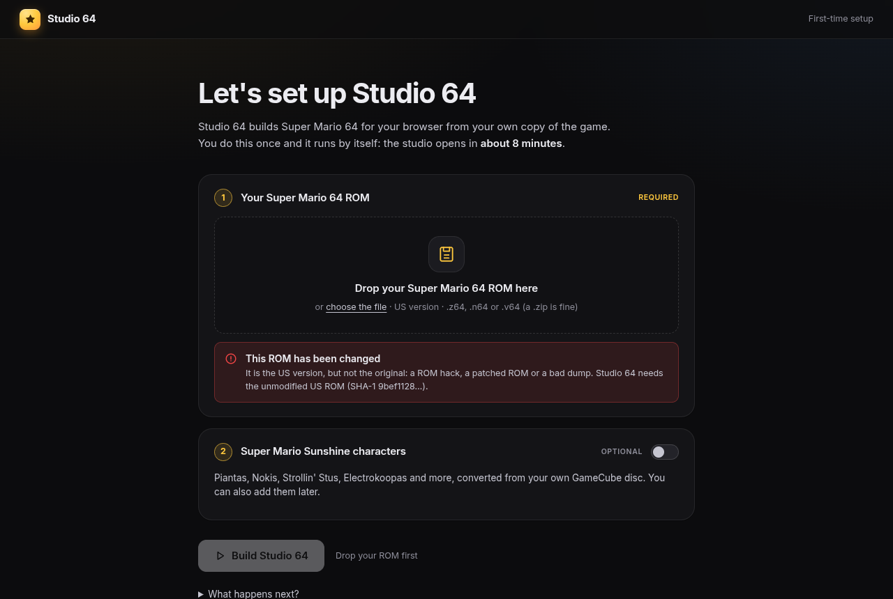
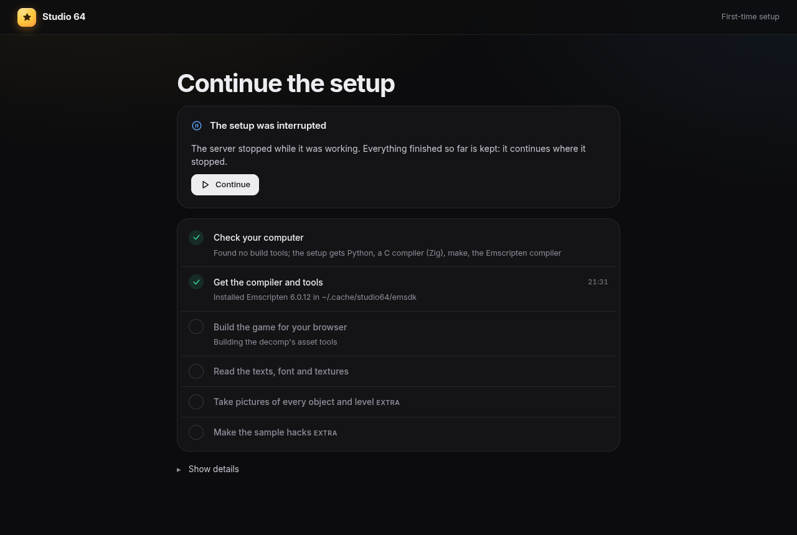
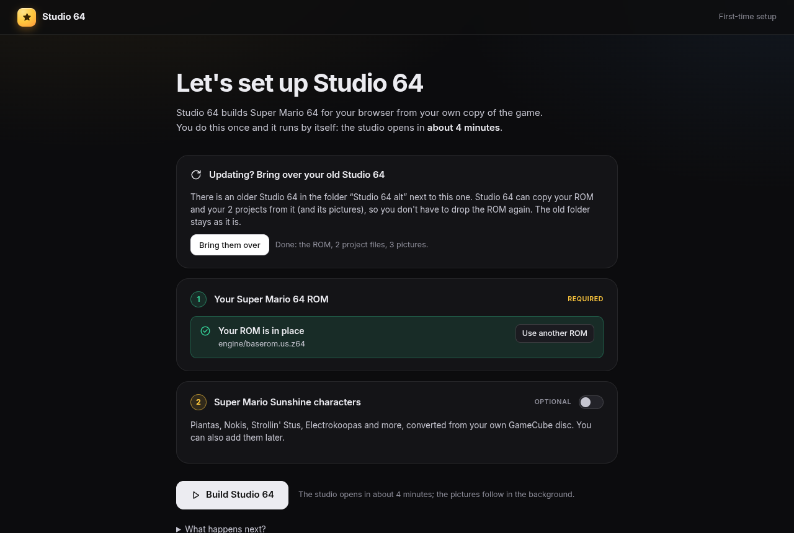
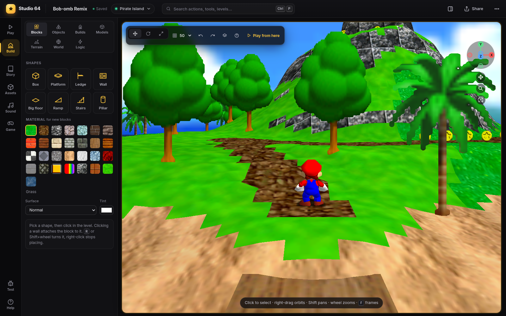

# Getting started

Studio 64 runs on Windows, macOS and Linux. You download one ZIP, double-click one file, and drop
your Super Mario 64 ROM into the page that opens. Everything else happens by itself. You don't
need to install anything, you don't need an administrator password, and you don't need to know
anything about programming.

- [What you need](#what-you-need)
- [Windows](#windows) · [macOS](#macos) · [Linux](#linux)
- [The setup page](#the-setup-page)
- [If something goes wrong](#if-something-goes-wrong)
- [Starting it again later](#starting-it-again-later) · [Updating](#updating) · [Uninstalling](#uninstalling)
- [For developers: git, npm and Docker](#for-developers-git-npm-and-docker)
- [First start](#first-start) · [Make your first hack in 5 minutes](#make-your-first-hack-in-5-minutes)

## What you need

- **Your own Super Mario 64 ROM**, the US version (a `.z64`, `.n64` or `.v64` file; zipped is fine).
  Studio 64 does not include the game.
- **Internet** the first time: about 1 GB is downloaded, once. Afterwards it works offline.
- **About 4 GB of free disk space.**
- **A web browser.** Google Chrome or Microsoft Edge work best (Studio 64 is tested in Chrome).
- Windows 10 or 11 (64-bit), macOS 13 Ventura or newer, or a 64-bit Linux from the last few years.

Download the ZIP of the latest version: **Releases → Studio 64 → `studio64-<version>.zip`**
(on the project's GitHub page, on the right). Don't use the green "Code" button: that one is for
developers.

## Windows

1. **Unzip it.** Right-click the downloaded file → **Extract All…** → **Extract**. A folder
   **Studio 64** appears. (Put it where you like, for example in Documents. Don't start it from
   inside the ZIP.)
2. **Start it.** Open the folder and double-click **Start Studio 64** (`Start Studio 64.bat`).
3. **If a blue box says "Windows protected your PC":** click **More info**, then **Run anyway**.
   Windows asks this once for files from the internet.
4. **A black window opens.** Leave it open while you use Studio 64: closing it stops Studio 64.
   The first time it downloads what it needs, which takes a few minutes.
5. **Your browser opens the setup page.** Drop your ROM on it and press **Build Studio 64**
   (see [The setup page](#the-setup-page)). After 5–10 minutes the studio opens by itself.

The setup downloads Node.js, Python and the build tools (w64devkit: a C compiler and make) into the
`Studio 64` folder and the compiler into `%LOCALAPPDATA%\studio64`. Nothing is installed in Windows,
and WSL is not needed. *(How well this is tested: see [What was tested](#what-was-tested).)*

## macOS

1. **Unzip it.** Double-click the downloaded file. A folder **Studio 64** appears next to it.
   (Move it where you like, for example into Documents.)
2. **Start it.** Open the folder, **right-click** (or Control-click) **Start Studio 64.command**
   and choose **Open**. macOS asks whether you are sure: click **Open**.
   - This is needed once, because Studio 64 is not from the App Store. If there is no **Open**
     button (macOS 15 Sequoia): open **System Settings → Privacy & Security**, scroll down, click
     **Open Anyway** next to "Start Studio 64.command", and start it again.
3. **A Terminal window opens.** Leave it open while you use Studio 64: closing it stops Studio 64.
   The first time it downloads what it needs, which takes a few minutes.
4. **Your browser opens the setup page.** Drop your ROM on it and press **Build Studio 64**.
   After 5–10 minutes the studio opens by itself.

You don't need Xcode or Apple's command line tools: if your Mac has none, the setup downloads a
compiler of its own (Zig), Python and make into the `Studio 64` folder. The compiler goes into
`~/Library/Caches/studio64`.

## Linux

1. **Unzip it.** Right-click the downloaded file → **Extract Here**. A folder **Studio 64** appears.
2. **Start it.** Open the folder, right-click an empty spot in it and choose **Open in Terminal**.
   Type this and press Enter:

   ```sh
   ./start-studio64.sh
   ```

   (If it says *Permission denied*, type `sh start-studio64.sh` instead. Some file managers also
   run it with a double-click: choose **Run** or **Run in Terminal**.)
3. **Leave the terminal open** while you use Studio 64: closing it stops Studio 64. The first time
   it downloads what it needs, which takes a few minutes.
4. **Your browser opens the setup page** (if not, open <http://localhost:8064>). Drop your ROM on
   it and press **Build Studio 64**. After 5–10 minutes the studio opens by itself.

From then on **Studio 64** is also in your applications menu. You don't need `sudo`, a compiler
or any packages: when your system lacks Python, a C compiler or make, the setup downloads them into
the `Studio 64` folder (Python from python-build-standalone, the Zig compiler, GNU make built from
source). The compiler goes into `~/.cache/studio64`. Tested on Ubuntu 22.04 and 24.04, Debian 12,
Fedora 44 and Arch Linux without any developer tools installed.

## The setup page



1. **Drop your ROM** on the page, or click **choose the file**. It is checked right away: a
   `.n64` or `.v64` file is converted, a zipped ROM is unpacked, and if it is another version
   (Japanese, European, a ROM hack) the page says so in plain words.

   

2. *Optional:* switch on **Super Mario Sunshine characters** and drop your own disc image.
3. Press **Build Studio 64** and wait. You can do something else meanwhile: the page shows what
   it is doing and how long it still takes.

   

| Step | What happens | First time |
|---|---|---|
| Check your computer | free disk space, which tools are there already | seconds |
| Get the compiler and tools | downloads what is missing: Emscripten (about 400 MB) and, if needed, Python, a C compiler and make | 2–6 minutes, depending on your internet |
| Convert the Sunshine characters | *only with the disc* | under a minute |
| Build the game for your browser | unpacks your ROM's textures, sounds and levels and compiles the game | 2–5 minutes |
| Read the texts, font and textures | for the Story and Assets tools | seconds |
| Take pictures of every object and level *(in the background)* | for the object library and the level list | 5–15 minutes |
| Make the sample hacks *(in the background)* | the examples on the home screen | 1–3 minutes |

When the game is built the studio opens by itself. The pictures and samples follow in the
background: start building right away, they appear when they are ready (until then the library
shows letters instead of pictures).



Everything stays on your computer. Your ROM is kept in the Studio 64 folder
(`engine/baserom.us.z64`) and is never uploaded anywhere.

**Updating from an older Studio 64?** If the old folder is next to the new one, the setup page
offers to bring over your ROM, your projects and the pictures with one click.

## If something goes wrong

The setup page says what went wrong and what to do, with a **Try again** button. Most problems
are solved by pressing it.

| You see | What to do |
|---|---|
| "Windows protected your PC" | Click **More info** → **Run anyway**. |
| macOS: "cannot be opened because the developer cannot be verified" | Right-click the file → **Open** → **Open**. Or **System Settings → Privacy & Security → Open Anyway**. |
| Linux: "Permission denied" | Type `sh start-studio64.sh` instead of `./start-studio64.sh`. |
| "This is the Japanese version" / "European version" / "This ROM has been changed" | Studio 64 needs the original **US** ROM. The byte order (`.z64`/`.n64`/`.v64`) doesn't matter. |
| "Unpack the archive first" | 7-Zip and RAR files are not unpacked for you: unpack it and drop the file inside. |
| "A download failed" / "Downloading Node.js failed" | Check your internet connection and press **Try again** (or start Studio 64 again). |
| The computer slept, or you closed the window during the setup | Start Studio 64 again and press **Continue**: it goes on where it stopped. |
| The browser did not open | Open <http://localhost:8064> yourself. (The window shows the address; if 8064 is taken by another program, Studio 64 uses the next free one and says so.) |
| "Not enough free disk space" | Free some space (about 4 GB), then **Try again**. |
| Anything else | On the setup page, click **Show details** → **Copy the whole log** and send it with your question. |

More: [Troubleshooting](troubleshooting.md).

| A wrong ROM is explained | An interrupted setup goes on where it stopped |
|---|---|
|  |  |

## Starting it again later

Double-click the same file again (Windows: **Start Studio 64**, macOS: **Start Studio 64.command**,
Linux: `./start-studio64.sh` or **Studio 64** in the applications menu). It opens in a few
seconds; nothing is built again, nothing is downloaded, and it works without internet. Your work is
saved all the time, in the `Studio 64` folder.

To stop Studio 64, close its window (or press `Ctrl+C` in it).

## Updating

1. Rename your old folder, for example to **Studio 64 old**.
2. Download the new ZIP and unzip it **next to** the old folder.
3. Start the new one. Its setup page offers **Bring them over**: your ROM, your projects and
   the pictures are copied from the old folder. Then press **Build Studio 64** (the compiler is
   already there, so this is quicker than the first time).

   
4. When everything is there, delete the old folder.

## Uninstalling

Delete the **Studio 64** folder (your projects are inside it: keep a copy of
`server/projects` if you want them, or export them first with **Share → Project file**). The
compiler is kept in one more folder, which you can delete too:

| | |
|---|---|
| Windows | `%LOCALAPPDATA%\studio64` (paste this into the Explorer address bar) |
| macOS | `~/Library/Caches/studio64` (Finder → **Go → Go to Folder…**) |
| Linux | `~/.cache/studio64`, and the menu entry `~/.local/share/applications/studio64.desktop` |

Nothing else was installed on your computer.

## What was tested

**Linux, automatically, from the release ZIP to playing** (`tests/setup/sandbox.mjs`, see
[Testing](testing.md#the-setup-on-clean-systems)): clean images of five distributions without any
developer tools (no compiler, no make, no git; Debian, Fedora and Arch without Python, Ubuntu and
Debian without xz), run as a normal user without root, the launcher started as a double-click
would, the browser wizard driven like a person, then a Goomba placed with the mouse and Mario
played. Each run downloaded everything itself (Node.js, Python where missing, Zig, make, the
compiler).

| System | Setup (ZIP → studio open) | Also tested |
|---|---|---|
| Ubuntu 24.04 | 5 min | a changed ROM and a text file refused in plain words, second start (1 s, nothing downloaded or built), no network at all |
| Ubuntu 22.04 | 25 min* | a `.v64` ROM, no `curl` (the launcher downloads with Python), second start |
| Debian 12 | 35 min* | a `.n64` ROM, everything stopped in the middle of the build and continued |
| Fedora 44 | 22 min* | the folder in `Spiele für Jörg/Neuer Ordner` (spaces and accents), wrong ROMs, second start |
| Arch Linux | 7 min | the folder in `Mes jeux/Été 2026`, no network at all |

\* on a machine that was busy with other work at the time (load average 30 on 12 cores); the 5–7
minute runs are what an ordinary computer takes. The pictures and sample hacks in the background
were tested on the developer's machine (also with an update brought over from an older folder).

**Windows and macOS: not on real machines yet.** The launchers were reviewed line by line; the
PowerShell launcher was run with PowerShell 7 (download, checksum, unpacking, arguments, a path with
spaces and accents) and checked with PSScriptAnalyzer against Windows PowerShell 5.1; the shell
launchers pass ShellCheck; the decomp's tools compile for macOS with the Zig compiler the setup
uses there. `.github/workflows/setup.yml` runs the real launcher and wizard on fresh `windows-2022`,
`macos-14` and `ubuntu-24.04` machines once the project is on GitHub (it needs your ROM through a
secret). Until it has run, please report problems.

## For developers: git, npm and Docker

With [Node.js](https://nodejs.org) 18+ installed you can skip the launchers:

```sh
git clone <this repository> studio64 && cd studio64
npm start            # the same as the launchers: installs the npm packages, opens the setup
```

The setup uses your system's Python 3.8+, C compiler and GNU make when they work, and downloads
only what is missing. `npm run build:engine` rebuilds the engine by hand (see
[Building the engine](building-the-engine.md)). `node tools/make_release_zip.mjs` makes the
release ZIP.

**Docker** (nothing else to install): `docker compose up` in the Studio 64 folder, then open
<http://localhost:8064> and drop your ROM. The image has Node, Python, the build tools, the
compiler and Chromium; the folder is mounted, so the built game and your projects land in it.

**WSL on Windows** still works too: start Studio 64 with `STUDIO_BUILD_HOST=wsl` to build inside
your WSL distribution instead of with w64devkit.

**Without the browser** (scripts, servers): copy the ROM to `engine/baserom.us.z64`, then
`npm run build:engine`.

**On a network:** `HOST=0.0.0.0 STUDIO_PASSWORD=pick-one npm start` makes the studio reachable
from other devices. All settings: [Settings](settings.md).

## First start

The browser opens the **home screen** (it opens by itself when there is no project to continue;
later you get back to it with the Studio 64 logo, top left):

- **Castle**: the original game to remix, starting at the castle grounds.
- **From scratch**: your own world without the castle. Pick a landscape for its first level.
- **Sample hacks**: finished examples to play and take apart.

Pick **Castle** for now. The studio opens:



| Where | What |
|---|---|
| **Top bar** | Project name and save state, the level you are in (click it to jump to another level), the search field (command palette), Share and the ⋯ menu |
| **Rail** (left) | The workspaces: **Play**, **Build**, **Story**, **Assets**, **Sound**, **Game**, and at the bottom **Test** and **Help** |
| **Stage** (middle) | The game itself, or the workspace you opened |
| **Side column** (right) | **Edits** (every change, each one can be undone) and **Stars** of this level; with an AI connected, the **Chat** too. `Ctrl+J` shows or hides it (without AI it starts hidden). |

Click the game to play. Mario runs with `W` `A` `S` `D`, jumps with `Space`, punches with `J`,
crouches with `Shift`, and `Enter` pauses. A gamepad works too. `Esc` gives the mouse back.
The full list is in [Keyboard shortcuts](keyboard-shortcuts.md).

A one-minute tour runs on the first visit. You can run it again from **Help → Take the tour**.

## Make your first hack in 5 minutes

Everything below works with the mouse and keyboard alone.

**1. Go to a level.** Press `Ctrl+K` (or click the level name in the top bar). The level
launcher shows every level with a picture. Click **Bob-omb Battlefield**. The game's star screen
appears; pick a star or wait a moment.

**2. Switch to build mode.** Press `Tab`. The game pauses and the mouse now edits the level.
Right-drag orbits the camera around what is under the mouse, `Shift`+drag pans, the wheel zooms.

**3. Place a platform.** In the library on the left, open **Blocks** and click **Platform**.
Click in the level to put it down (click again to place more; right-click or `Esc` stops).
Click the platform to select it, then:

- drag it over the ground, or press `1` for the move arrows (hold `Shift` while dragging to move it up and down),
- press `3` and drag a face to resize it,
- pick a material (bricks, ice, lava, ...) in the inspector on the left.

**4. Add some life.** Open **Objects**, search for `goomba` and click it, then click on the
ground a few times. Do the same with `coin`. Every object of the game is in the library, about
600 of them, by category.

**5. Add a star.** Open the **Stars** tab in the side column (`Ctrl+J` if it is hidden), click **Add star**, name it
("On top of the platform") and click where it goes.

**6. Play it.** Press `Tab` to play again (or **Play from here** in the build bar to start right
where the camera looks). Jump on your platform, stomp the Goomba, collect the star: the game's
"course complete" screen shows your star's name.

**7. Undo anything.** `Ctrl+Z` undoes the newest edit, and the **Edits** tab lists
every change, each with its own undo button.

That's it: your hack is saved on the server after every edit. Reload the page, die, change level:
your changes are always there.

Next things to try:

- `Ctrl+K` → **New level** for a level of your own from a template (island, mountain, desert, ...).
- The **Terrain** tab to raise hills and paint the ground. See [Levels and terrain](levels-and-terrain.md).
- **Builds** for staircases, bridges and towers in one click. See [Build mode](build-mode.md).
- **Sound** (`M`) to compose the level's music. See [Sound studio](sound-studio.md).
- **Story** (`Y`) for characters that talk and events. See [Story](story.md).

## Play and share it

- **Share → Playable game** gives a zip with a small website: the game, your hack and a player
  page. It runs from any static web host, without the server. See [Projects](projects.md).
- **Share → Project file** gives a `.s64hack` file: the whole project to open in another Studio 64.
- The project link (`/?p=<id>`) lets others on your network edit the same project live. See
  [Running on a network](#running-on-a-network) below.

> The playable game contains Nintendo's code and assets from your ROM. Play it yourself or share
> it privately with people who own the game; do not publish it or sell it.

### Running on a network

```sh
HOST=0.0.0.0 STUDIO_PASSWORD=pick-one npm start
```

This makes the studio reachable from other devices on your network. Always set a password when
you do this. For friends elsewhere, put a tunnel in front of it (for example
`cloudflared tunnel --url http://localhost:8064`).

All server settings are listed in [Settings](settings.md).

## Where to go next

- [Build mode](build-mode.md): every editing tool.
- [Keyboard shortcuts](keyboard-shortcuts.md): all keys on one page.
- [Glossary](glossary.md): SM64 words like *area*, *act*, *bparams* and *warp node*.
- [Troubleshooting](troubleshooting.md): when something does not work.
- [All docs](README.md).
