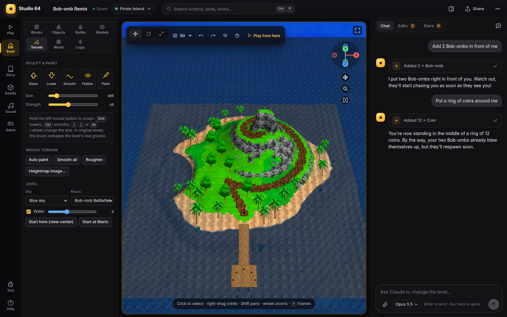

# Levels and terrain

Jump to any level, make new ones, and shape the ground with brushes.

- [Jumping between levels](#jumping-between-levels)
- [Making a new level](#making-a-new-level)
- [Your levels are courses](#your-levels-are-courses)
- [Terrain brushes](#terrain-brushes)
- [Level settings](#level-settings)
- [Areas, warps and the hub](#areas-warps-and-the-hub)

## Jumping between levels

Press `Ctrl+K`, or `L` when you are not playing, or click the level name in the top bar. The
**level launcher** shows your own levels and all original levels with pictures; type to search,
`Enter` opens the first match.

Every jump opens the level's **star screen**, the game's own act selector. It lists the level's
stars (the original acts, the 100-coin star and your own stars), collected ones bright. Pick a
star with the stick and A, or let it go on by itself after a moment. If you were building, you
land back in build mode with the camera where you left it in that level.

Each card of your own levels has a menu (⋯) to **rename**, **duplicate** or **delete** it.
Creating, renaming, duplicating and deleting levels can be undone from the **Edits** tab.

## Making a new level

In the launcher, click **New level**. Pick a **template**. Each one is a finished base to start
from, with walkable paths, a landmark built from blocks, trees, wildlife and a few coins:

- **Tropical island** with a pier
- **Rolling meadow** with a lookout hill and a pond
- **Mountain** with a spiral trail
- **Desert dunes** with a pyramid and an oasis
- **Snow land** with an ice slide and a cabin
- **Lava land**: islands and a volcano
- **Canyon**
- **Flat grass**: an open field to build on
- **Sky islands**
- **Tokyo** (only when it was imported from a Shoggoth World checkout): the whole night city of
  Shoggoth World, with its neon, Japanese signs, traffic, train, people, yokai, sky and music, as
  one level to play or keep building on. See [Tokyo template](tokyo-template.md).

**From an image:** drop a picture on *Or from an image*. Without AI it is used as a
**heightmap**: bright is high, dark is low, and it becomes the shape of the ground. With an AI
connected you can also let it build the level from a sketch, a map or concept art.

Custom levels live in their own level slot of the engine (see [Architecture](architecture.md)),
so you can make as many as you like. A level can have up to 7 **areas** (rooms, caves, the inside
of a house); see [World](world.md#areas).

## Your levels are courses

Your levels behave like the game's own courses:

- they open with the star screen,
- the pause menu shows the course name, the star you are playing, MY SCORE, red coins and
  **Exit Course**,
- collecting a star ends the level with the course complete screen,
- 100 coins give the 100-coin star,
- dying sends Mario back (to the castle, or to your [hub](world.md#hub-and-flow-patchworld)) with
  a life less,
- the castle's pause menu pages through them after the original courses.

## Terrain brushes

Open the **Terrain** tab in build mode and pick a brush:

| Brush | |
|---|---|
| **Raise** | Pulls the ground up |
| **Lower** | Pushes it down |
| **Smooth** | Evens out bumps |
| **Flatten** | Levels the ground to the height where the stroke started |
| **Paint** | Paints a material (grass, sand, snow, rock, ...) |

Hold the left mouse button over the ground to use it. `Shift` inverts (raise becomes lower),
`Ctrl` smooths, and `[` `]` or `Alt`+wheel change the brush size. The **Size** and **Strength**
sliders do the same. Each stroke is one edit you can undo.

**In your own levels** the ground is a 64×64 heightmap (128 units per cell) painted with the
block materials. Extra buttons work on the whole terrain:

| Button | |
|---|---|
| **Auto paint** | Grass on flat ground, rock on slopes, sand by the water |
| **Smooth all** | Smooths everything a little |
| **Roughen** | Adds natural bumps |
| **Heightmap image…** | Replaces the ground with a picture (bright = high) |

**In original levels** the same brushes (all but Paint: original levels keep their textures)
reshape the level's real ground: Studio 64 copies the
level's geometry and collision into an editable mesh, splits it finely where you paint, and the
collision follows. The strokes are saved and replayed every time the level loads.

## Level settings

Under the brushes in the Terrain tab:

| Setting | |
|---|---|
| **Sky** | Ten of the game's skyboxes (your own levels). For your own pictures or a generated sky, see [Assets: skies](assets.md#skies). |
| **Music** | Any of the game's songs, or one of yours from the [sound studio](sound-studio.md). *Compose a song…* opens it. |
| **Water** | Water on/off and its height (your own levels) |
| **Start here / Start at Mario** | Where Mario starts the level |

Fog, light, weather, ambient sounds and the camera mode are per area; see
[World: environment](world.md#environment-of-an-area-settingsenv).

## Areas, warps and the hub

Doors and pipes between levels, sub-areas, paintings, the hub Mario returns to and where a new
game starts: all of that is in the **World** tab and documented in [World](world.md).
