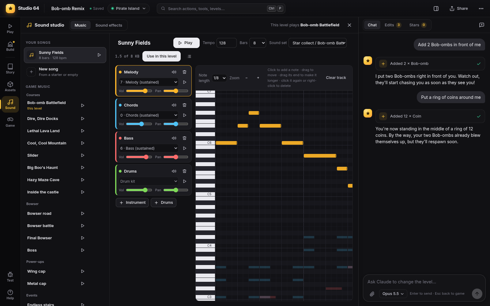

# Sound studio

Compose music that plays through the game's own sound engine, and make or record sound
effects that replace the game's. Open it with **Sound** in the rail or the `M` key; `Esc` closes it.

- [Music](#music)
- [Sound effects](#sound-effects)
- [Limits](#limits)
- [How it works](#how-it-works)

## Music

The **Music** tab lists your songs and all of the game's music.

**Listen and pick.** Every song of the game is there, grouped (courses, Bowser, power-ups,
events, ...), with a play button. The level's music is chosen in build mode's
[Terrain tab](levels-and-terrain.md#level-settings), which lists your songs too.

**Compose.** Click **New song** and start from a starter or from nothing:

| Starter | |
|---|---|
| Sunny Fields | Bouncy course music with drums |
| Snowy Night | Slow and calm, sustained chords |
| Lava Rush | Fast and tense, for danger |
| Deep Water | Floating arpeggios |
| Empty song | Start from nothing |

**Import a MIDI file.** Made a song in another music editor (a DAW, MuseScore, a tracker)? Save it
as a MIDI file (.mid) and click **Import MIDI**, or drop the file on the sound studio. Every part
of the file (a track, or a channel of one) is listed with what it played and how many notes it
has, and gets one of the game's instruments:

- The **sound set** is the band the song plays with; one with drums is picked when the file has
  drums. Change it and the parts get that set's instruments.
- Each part's instrument is picked from its General MIDI instrument (a bass part gets a bass, a
  piano chords, a flute a melody, drums on channel 10 the drum kit). Pick another from the list
  and press ▶ to hear it. Untick a part to leave it out (12 at most).
- **Timing** is the finest note kept: 1/16 notes, 1/32 notes, or 1/16 notes with triplets.
- **From bar** and **Bars** keep a part of a long song (it loops after the last bar); **Tempo** is
  the file's. The game plays 40 to 240 bpm: a faster file counts in half time, a slower one in
  double time, and sounds the same.
- **Listen** plays the result with the game's sequence player. Below the parts it says when
  something does not fit: too long for the game's song memory, or more notes at once than the
  game can play.
- **Import** makes it a song: it opens in the editor below, where everything (instruments,
  notes, volumes) can still be changed.

The editor:

- **Sound set**: the band. Each of the game's songs uses a set of instruments; pick the set of
  one of them (for example *Star collect / Bob-omb Battlefield*).
- **Tracks**: **+ Instrument** adds a track with one of the set's instruments, **+ Drums** a drum
  track. Each track has volume, pan, mute and a preview button.
- **Piano roll**: click to add a note, drag to move it, drag its end to make it longer, click it
  again or right-click to delete it. *Note length* sets the length of new notes.
- **Tempo** (40 to 240 bpm) and **Bars** set the song's length and speed.
- **Play** plays the song through the game's own sequence player, so it sounds exactly like it
  will in the game. Every note sounds for its whole written length (then its instrument's own
  release rings out).
- **The playhead**: the yellow line. Click the time ruler above the roll, or drag the line (on the
  ruler or on the roll), to play from that spot: it snaps to beats (`Alt`: to steps) and plays
  from there when you let go, a note that is sounding there included. **Play** and `Space` start
  at the playhead; while playing, the roll scrolls along with it.
- **Use in this level** makes it the music of the level you are in.
- **⋯ → Play instead of a game song…** makes it play everywhere the game plays one of its songs
  (see below).

**Replace the game's songs everywhere.** In the *Game music* list, hover a song and click
**Replace**, then pick one of your songs: it plays wherever the game plays that song, in every
level that has it, in the castle, in the menus, in the [exported ROM](rom-export.md) too. Replace
*Slider* once and the slide and every level with slide music play your song. Levels that picked
their own music keep it, and a level can still pick any song for itself. The game's
**jingles and fanfares** (Star collect, Star appears, Puzzle solved, Key collect, High score) are
replaced the same way: your song then plays **once** and ends, so keep a jingle to a bar or two.
The list shows *→ your song* under a replaced song (its ▶ plays the replacement), the composer
shows *Plays everywhere instead of …* with an ✕ to bring the game's own back, and deleting the
song brings it back too.

## Sound effects

The **Sound effects** tab has your own sounds and the game's.

**Make a sound** (*Synth*): a small retro synthesizer. Start from a preset (coin, jump,
power-up, laser, explosion, hit, blip, bounce, magic, 1-up, hurt, wind), press **Random** for
a surprise or **Vary it** for a variation of the current sound, and adjust the sliders.

**Record or upload** (*Recording or file*): **Record** up to 5 seconds with your microphone, or
**Choose a file** (mp3, wav, ogg).

**Replace a game sound.** **Game sounds** lists the game's sound effects (about 400) to listen
to. Pick one and **Replace** it with one of yours, or use **Use instead of a game sound…** on
your sound. From then on your sound plays everywhere the game uses that one: every coin, every
jump. The list on the left shows which game sounds you replaced.

**Mario's sounds.** Pick *Mario* in the list's menu: every sound of Mario, grouped: his voice
(jumps, punches & lifts, hurt, tired & sleepy, lines, the two lines the game never plays),
footsteps, jumps & landings and slides on each kind of ground (grass, stone, snow, sand, wood,
ice, shallow water, the rest), moves, water and metal Mario. Each entry is one sound: the game
picks the jump voice at random from three ("Yah!", "Wah!", "Hoo!"), the triple jump's from five
(three of them "Yahoo!", the same clip as the long jump's), the footstep by the ground; replace
"Yahoo!" and every yahoo is yours, replace *Step: Grass* and only the steps on grass change.

**Beta sounds** (the switch above the list) gives Mario's voice the clips of your game that it
never plays: the jump's "Yah!" becomes the unused first take that sits in the voice bank next to
"Wah!" and "Hoo!" (the game's own "Yah!" borrows the punch's), and the triple jump says yah, wah
or hoo as in the 1996 Japanese original ("Waha!" and "Yippee!" came with the US release). The
clips come from your own ROM. A sound you replaced plays instead, beta or not. It is saved in the
project and works in the exported ROM.

## Limits

- A song can have up to 12 tracks. A track plays four notes at once on its own channel; with
  more (big chords) the notes go to spare channels, 16 channels in all. The game sounds 16 notes
  at once in total, its sound effects included: in the busiest moments the quietest drop out.
- A song must fit the game's sequence cache: about 8 KB of sequence data. The editor shows how much
  is used ("1.5 of 8 KB").

## How it works

- Songs are encoded to the game's own sequence format (`.m64`) in the browser (`web/js/music.js`)
  and installed into two sequence slots that Studio 64 does not otherwise use: one for level
  music, one for previews (`engine/src/studio/audio.c`).
- A note is `layer_note0` with its length, velocity and *gate*: the part of the length that is
  left when the note is released (gate/256). Songs use gate 0, so a note holds to its end; a legato
  track (`legato: true`) also turns on the layer's continuous notes (`0xC4`), so notes that follow
  each other glide on without a new attack. Tests read how long a note really sounds with
  `_studio_music_layer(channel, layer)` (`tests/suite/music_notes.test.mjs`).
- Playing from the playhead is `encodeSong(song, { from })` (in steps): each channel first runs
  layers that join the song's own there (what is left of the note sounding at that moment, or a
  rest until the next one, then a `layer_jump` into the song's own layer), waits for the rest of
  the first time through, and then loops the whole song as usual. `from` 0 encodes the song
  exactly as without it.
- A replaced game song (`project.audio.replace`: `[{ seq, song }]`) puts the song in that game
  song's own sequence slot (`studio_song_replace`; the original is kept and put back when the
  replacement goes), so everything that plays the slot plays the song. Jingles are encoded with
  `encodeSong(song, { once: true })`: the sequence ends after the last bar and a beat instead of
  looping. In the ROM, `s64_songs.c` does the same at boot from a table in the info block
  (`replaceRom`, `replaceCount`).
- Instrument names come from `tools/analyze_instruments.py` (with `tools/seq_usage.py`), which
  names the instruments of every sound set from the samples and from how the game's songs use
  them (`web/data/instruments.json`). `tools/gen_sounds.py` lists the game's sound effects
  (`web/data/sounds.json`).
- Replaced game sounds hook `play_sound` (`audio.c studio_sfx_hook`; in the ROM `s64_sfx.c`). A
  sound is matched as one sound under all its ids: `studio_sfx_canon` finds the first id of its
  bank whose entry in the sound player's table points at the same sound script (each bank is a
  channel of the sound player sequence, its sounds a table), so random variants and duplicates
  are the same sound. The Mario list is `tools/gen_sounds.py` (`MARIO`: sub-group, name, define,
  id offset, note); Mario's other names of the same sounds are kept in `sounds.json` as
  `hidden` entries, so custom objects that use them still find them.
- Beta sounds (`project.audio.beta`, the `audio_options` message, `studio_voice_beta`): the voice
  bank `sfx_mario` has an instrument no sound script uses (instrument 2: a "yah" take between the
  jump's "hoo" and "wah"); with beta on, the jump "yah" script's `chan_setbank 10, chan_setinstr 9`
  becomes `chan_setbank 8, chan_setinstr 2` in the loaded sound player sequence (patched again
  whenever the sequence is loaded again), and the triple jump's ids 0x2B-0x2F play 0x00-0x02.
  `studio_voice_script(id)`, `studio_sfx_channel(ch)` and `studio_sfx_recent(i)` are for tests
  (`tests/suite/mario_sounds.test.mjs`).
- The synthesizer is `web/js/sfx.js`; the studio is `web/js/sound_ui.js`.
- Songs and sounds are saved in the project, so the [playable game](projects.md#playable-game-standalone-export)
  and the project file include them.
